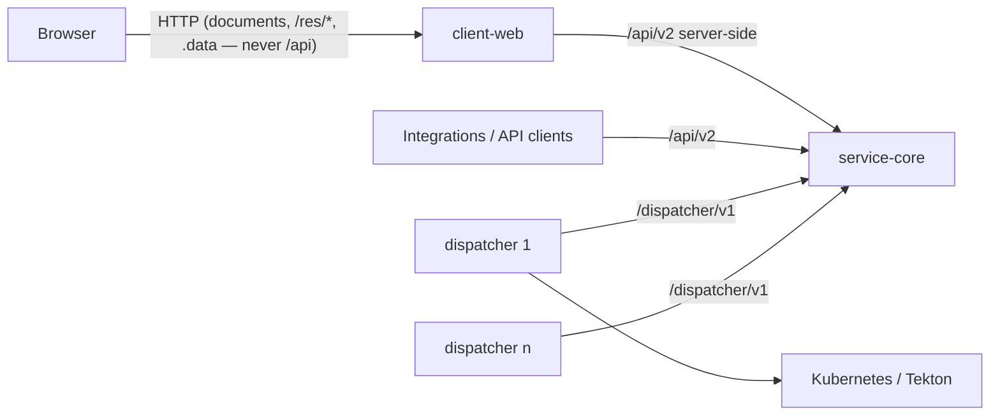

# Boomerang Flow Monorepo

Boomerang Flow is an open-source, cloud-native, low-code/no-code workflow automation platform. Workflows
execute as Directed Acyclic Graphs (DAGs). Apache-2.0 licensed.

This repository holds the whole product — services, migrations, and the web application.

| Module | Role |
|---|---|
| [`service-core`](./service-core) | The deployable: v2 REST API, auth/authz, workspaces, workflows, **and** the DAG execution engine. One shape; properties express the deployment (see [Deployment shape](#deployment-shape)). Migrates and seeds its database as it starts (Flamingock change units in `io.boomerang.migration`). |
| [`dispatcher-sdk`](./dispatcher-sdk) | The dispatcher protocol as a Java library, published to GitHub Packages as `io.boomerang:dispatcher-sdk`: write a dispatcher by implementing `TaskHandler`; the SDK registers, polls, starts, renews leases and reports ends. |
| [`flow-sdk`](./flow-sdk) | The public API as a Java library, published to GitHub Packages as `io.boomerang:flow-sdk`: `Flow.connect(url, token)`, then typed calls to submit, read, cancel and retry workflow runs, query runs and task runs by label, and read Insights. Its version is the server version it was built against; `/api/v2` is additive within 5.x. |
| [`service-dispatcher`](./service-dispatcher) | Flow's Kubernetes dispatcher, built on `dispatcher-sdk`: one implementation of the published dispatcher contract (`contracts/dispatcher-v1.yaml`, `specifications/dispatcher-contract.md`). Per-task runtime behind the `io.boomerang.executor.TaskExecutor` SPI, selected by `dispatcher.executor`: `tekton` (default) or `kube-jobs`. Any process that implements the contract is a dispatcher; it runs as its own deployable only where a boundary (credentials, network zone, trust, placement) separates it from core. |
| [`client-web`](./client-web) | The web application — React 18 + React Router 7 (framework mode, SSR) + IBM Carbon v11. BFF model: the browser talks only to its SSR server (documents, `/res/*` resource routes, `.data` requests — never `/api/*`); all service-core calls happen server-side. No react-query — data flows through route loaders/actions. Its own image; renders from the `/api/v2/features` flags, so it runs against any deployment shape. |
| [`e2e`](./e2e) | Playwright end-to-end suite. Drives the real UI against a real backend, so it lives at the repo root rather than under `client-web`. |

Other top-level folders:

| Folder | Holds |
|---|---|
| [`contracts`](./contracts) | `dispatcher-v1.yaml`, the OpenAPI contract between `service-core` and any dispatcher. |
| [`specifications`](./specifications) | Reference docs for each subsystem as it works today, and numbered decision records (`decisions/`). |
| [`docker`](./docker) | Support files for the local stack and images: the IDPZero OIDC provider's config, Mongo seed scripts, SeaweedFS config, the kubeconfig for the dispatcher, and the shell-less container health probe (`health/Health.java`). |
| [`load`](./load) | A dependency-free Node load harness that submits runs against `service-core` and reports latency and throughput. |
| [`scripts`](./scripts) | One-off operator scripts, such as a read-only `mongosh` audit of the tokens collection. |



`service-flow` and `service-engine` were separate deployables in v4 and are now merged into `service-core`.
The dispatchers pull work from `service-core` and report back over `/dispatcher/v1/**`. The one call in the
other direction is a task's live log, read from the dispatcher holding the claim at the URL it registered; a
finished log a dispatcher stored is served from the artifact store instead.

Every image is a multi-stage build from a clean checkout (`docker build -f service-core/Dockerfile .`,
`docker build -f service-dispatcher/Dockerfile .`, `docker build client-web`): Maven and pnpm run inside
the build stage, and the release workflow builds nothing on the runner first.

## Prerequisites

1. **Java 25** — check this first if Maven fails. The default `java` on a dev machine is often still 21, and
   Maven then reports `class file version 69.0 ... only recognizes ... up to 65.0`, which reads like a code
   error but is purely a toolchain mismatch.
   ```bash
   export JAVA_HOME=$(/usr/libexec/java_home -v 25)   # macOS; verify with: java -version
   ```
2. Spring Boot 4.1
3. Maven
4. Node + pnpm (for `client-web`)
5. Docker (for the local stack and the Testcontainers-backed tests)

## Running locally

`docker-compose.yml` is the local stack: MongoDB (in the `mongo_data` volume, kept until
`docker compose down -v`), a local IDPZero OIDC provider for real sign-in, SeaweedFS as the S3-compatible
artifact store, and two one-shot seeds that point the settings at them. Every image builds from a clean
checkout: the Java Dockerfiles run Maven in a build stage and `client-web`'s runs pnpm, so nothing is built
on the host first. Published `boomerangio/*` images are the v4 line and will not match this branch.

`client-web`'s own SSR server is the single browser-facing origin and the only thing the browser talks
to: it serves documents, `/res/*` resource routes and `.data` requests, and every service-core call
happens server-side via `CORE_SERVICE_INTERNAL_ORIGIN` (`client-web/src/Config/serverFetch.ts`). There is
no `/api` forward and no separate gateway; `/api` remains service-core's own surface for integrations and
the dispatcher.

### The whole product in Docker

```bash
docker compose --profile stack up -d --build
```

The `stack` profile adds `service-core` (which migrates and seeds the database before it serves anything)
and `client-web`. This is what the e2e suite runs in GitHub Actions.

| Surface | URL |
|---|---|
| `client-web` — the single browser-facing origin (use this for manual testing and E2E) | http://localhost:3000 |
| `service-core` direct — the `/api` surface for integrations, the dispatcher, and test setup (the webapp never uses it from the browser) | http://localhost:7700 |

The stack runs secured (`FLOW_SECURITY_ENABLED=true`) with the real sign-in flow against the local
IDPZero user picker; the first user to sign in on a fresh database becomes the founding admin.

### Developing: the services on the host, the rest in Docker

```bash
docker compose up -d                                                        # Mongo, IDPZero, SeaweedFS, seeds
export JAVA_HOME=$(/usr/libexec/java_home -v 25)
mvn -pl service-core -am spring-boot:run -Dspring-boot.run.profiles=local   # the API + engine on :7700
cd client-web && pnpm install && pnpm dev                                   # the webapp on :3000, hot reload
```

The `local` Spring profile (`service-core/src/main/resources/application-local.properties`) carries the
stack's addresses and the same local-only encryption keys the stack uses, so one database serves both
ways of running. The seeds wait for `service-core` to migrate the database, wherever it runs.

`pnpm dev` is React Router's dev server: a change to the frontend is live in the browser without a
rebuild, and its loaders call `service-core` on the host at http://localhost:7700 unless
`CORE_SERVICE_INTERNAL_ORIGIN` says otherwise. `pnpm run build && pnpm start` runs the same built server
the image runs (`react-router-serve`), for checking a change the way production serves it.

### The dispatcher

`service-dispatcher` drives a Kubernetes cluster, so it sits behind a compose profile. Against OrbStack's
Kubernetes with the plain-Jobs executor (the kubeconfig at `docker/kube/config` is described on the
service in `docker-compose.yml`):

```bash
docker compose up -d --build service-dispatcher     # naming the service enables its profile
```

It reaches `service-core` on the host by default; set `FLOW_ENGINE_SERVICE_HOST=service-core:7700` to pair
it with the `stack` profile. The dispatcher scenarios then run with
`cd e2e && E2E_DISPATCHER=true E2E_KUBECTL_CONTEXT=orbstack npx playwright test tests/dispatcher-kube.spec.ts`.

### End-to-end tests

```bash
cd e2e && npm ci && npx playwright test    # requires the stack to be up and the webapp on :3000
```

## Deploying behind a reverse proxy

Any proxy or ingress fronting `client-web` MUST forward the `Host` header **including the port**
(nginx: `proxy_set_header Host $http_host;`, not `$host`). React Router 7's CSRF protection
compares each action POST's `Origin` against the server-reconstructed request host; a proxy that
strips the port makes the two differ and every form submission fails with HTTP 400. The REST API
(`/api/**`) is unaffected - this applies only to the webapp.

## Packaging and releases

One product tag builds the whole compatible image set — there is no per-service version line. Tags match
`5.x.y`, optionally with a `-beta.N` or `-rc.N` suffix:

```
5.0.0
5.1.0-beta.3
```

Use the `/release` skill. An SBOM/CVE pipeline exists (`.github/workflows/sbom.yml`, `/cve-review` skill).
Operator-facing changes for the next release are collected in [`CHANGELOG.md`](./CHANGELOG.md) as they merge.

## Upgrading from v3

`service-core` migrates its database as it starts, before it serves anything: there is no separate loader
Job. The migrations take exactly two starting points to the current shape, an **empty database** and a
**v3 database**. A v4 database, or one a 5.0 beta already migrated, is refused at startup with a message
saying why; reset it, or restore the v3 database it came from.

Before the first start against a v3 database:

1. **Back up the database.** The migration is forward-only; the v3 source collections are dropped once
   migrated.
2. **Check for two users sharing one email.** The migration refuses to delete an account, so a shared
   email fails the unique index and startup with it. Two addresses that differ only by case are kept as they
   are and logged; lower-case the survivor by hand afterwards.
3. **Set the encryption keys.** v3 encrypted secured settings (Slack and GitHub credentials) with the pair in
   `mongo.encrypt.secret` and `mongo.encrypt.salt`, set on the v3 deployment; a v3 instance that never set
   them holds no encrypted values. Provide that same pair under the same names: it is read once, to decrypt
   those values during the migration. Provide the key v5 encrypts with as
   `flow.encrypt.secret` and `flow.encrypt.salt`; it can be a fresh pair, and it is required on every
   install. A wrong v3 pair stops startup rather than leaving a credential unreadable.
4. **Give the pod time to migrate.** No HTTP is served until the migrations finish. A 16 MB v3 database
   migrates in under a minute; set the startup probe for the largest instance's run history, and roll out
   one replica first. Replicas that start together wait on the migration lock for up to 30 minutes.
5. **Export any run history you need to keep.** v5 deletes finished runs older than its Activity retention,
   365 days by default, with their task runs, approvals, logs and run artifacts. The purge starts within a
   minute of the first start and removes up to 1000 runs an hour, before the setting can be changed, and no
   value turns it off. This is by design: Activity is bounded from day one. Workflows, workflow-scoped
   artifacts and the audit trail are kept.

Remove the `flow-service-loader` Job and image from the deployment: one product tag now builds
`flow-service-core`, `flow-service-dispatcher` and `flow-client-web`.

## Design details

### Parameters and results

Modelled on Tekton params and results. Tekton requires a spec for a JSON object before you can reference
child elements; Flow does not — the path after `params.<param-name>` is taken as given.

### Execution model

Work is claimed atomically with `findAndModify` — there are no distributed locks. Contended state
transitions use a status Compare-And-Set rather than optimistic-locking retries, and crash recovery is a
set of level-triggered sweeps in `WorkflowWatcher` that any instance can run. The `acquirelock` and
`releaselock` task types use the `task_locks` collection.

### Indexes

MongoDB index creation is owned entirely by the change units in `io.boomerang.migration`. Entity `@Indexed` and
`@CompoundIndex` annotations are **inert** — `spring.data.mongodb.auto-index-creation=false` — so an
annotation without a matching change unit creates no index.

## Error handling

All API errors use `io.boomerang.common.error.RestErrorResponse`:

| Field | Description |
|---|---|
| timestamp | UTC timestamp of when the error occurred |
| code | unique identifier (int) for handling errors programmatically |
| reason | unique identifier (string) for searching for more information |
| message | a description intended for a human end user |
| status | HTTP status code and message |
| cause | present only when `flow.error.include-cause=true` |

```json
{
  "timestamp": "2023-01-31T00:15:12.672+00:00",
  "code": 1001,
  "reason": "QUERY_INVALID_FILTERS",
  "message": "Invalid query filters(status) have been provided.",
  "status": "400 BAD_REQUEST",
  "cause": null
}
```

Known codes are indexed in `io.boomerang.common.error.BoomerangError`, with the message text in
`messages.properties`. A custom exception can be thrown instead, at the cost of localisation.

## Deployment shape

There is one `service-core`; two properties express how it is deployed
(`service-core/src/main/resources/application.properties`):

| Property | Default | Effect |
|---|---|---|
| `flow.security.enabled` | `true` | The single switch for authentication and endpoint authorization. With it `false`, every request runs as a synthetic admin; set it only for a headless embedded engine or local development. |
| `flow.workspace.single` | `false` | With it `true`, only the seeded `system` workspace is served and workspaces cannot be created or deleted. An embedding product sets it together with `flow.security.enabled=false`. |

These security classes load on `flow.security.enabled`:

| Class | Loaded when |
|---|---|
| `AuthenticationFilter` | true |
| `MethodSecurityConfiguration` (and so `AuthCriteriaAuthorizationManager`) | true |
| `SecurityConfiguration` | true |
| `SecurityDisabledConfiguration` | false |

Runtime limits such as quotas, retention and the audit switch are admin settings (seeded from
`service-core/src/main/resources/seed/settings.json`), not properties.

## History

The v3 → v4 rewrite of the engine is documented in:

- [Model changes and v3 to v4 model comparison](https://github.com/boomerang-io/roadmap/issues/368)
- [Distributed async architecture change](https://github.com/boomerang-io/architecture/tree/feat-v4)

## Community and contributing

- Bugs and features: [open an issue](https://github.com/boomerang-io/flow/issues/new/choose) — see [CONTRIBUTING.md](CONTRIBUTING.md).
- Questions: the [Boomerang Slack](https://join.slack.com/t/boomerang-io/shared_invite/zt-pxo2yw2o-c3~6YvWkKNrKIwhIBAKhaw) — see [SUPPORT.md](SUPPORT.md).
- Security: [SECURITY.md](SECURITY.md). Maintainers: [MAINTAINERS.md](MAINTAINERS.md). Roadmap: [ROADMAP.md](ROADMAP.md).

The former central tracker, [`boomerang-io/community`](https://github.com/boomerang-io/community), is archived; its
open issues were triaged into this repository on 2026-09-01 and its old URLs redirect.
